# Ferris Sweep Keymap (ZMK)

This repository has the ZMK configuration for a Ferris Sweep keyboard. The keyboard has two
nice!nano v2 controllers.

The keymap file is `config/cradio.keymap`. ZMK uses the name "cradio" for the Ferris Sweep
shield.

For more information, refer to the ZMK documentation: <https://zmk.dev/docs/>

## Layers

Run `./draw-keymap.sh` to make the image again after a change to `config/cradio.keymap`.

## Flash Procedure

Do this procedure to flash new firmware on the keyboard.

1. Push the reset button on one half two times. This puts the half in bootloader mode.
1. Drag the file `settings_reset-nice_nano_v2-zmk.uf2` to the drive with the name `NICENANO`.
1. Wait until the LED stops and the drive disconnects.
1. Do step 1 to step 3 again for the other half.
1. Push the reset button on the left half two times.
1. Drag the file `cradio_left-nice_nano_v2-zmk.uf2` to the `NICENANO` drive.
1. Push the reset button on the right half two times.
1. Drag the file `cradio_right-nice_nano_v2-zmk.uf2` to the `NICENANO` drive.
1. Supply power to both halves.

Note: Do steps 1 to 3 (the settings reset procedure) only in two cases: before the first flash,
or to remove old Bluetooth bonds.

The left half is the central half. Connect the left half to the computer or the phone. The
right half is the peripheral half. The right half connects to the left half with a Bluetooth
Low Energy (BLE) link.

To connect the keyboard to a different host, do these steps:

1. Hold the NUM key and the NAV key together to get to the FUN layer.
1. Push a BT key (BT1, BT2, or BT3) to select a profile.
1. Connect the new host to the keyboard.

To remove a Bluetooth bond, push the BT clr key.

The USB/BT key changes the output between USB and Bluetooth.
